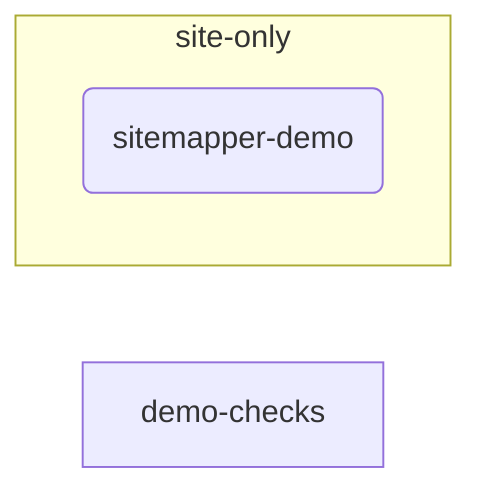

# Inventory

**Generated by `scripts/inventory.py` — do not edit.** Change the YAML and
re-run. `python scripts/inventory.py --check` fails if this file is stale.

2 sites · 1 apps · 1 projects · 3 workflows (1 agentic, 2 deterministic)

## Projects

| Project | Kind | App | Sites | Workflows | Schedule | Purpose |
|---|---|---|---|---:|---|---|
| `demo-checks` | test | sitemapper-demo | — | 1 | — | The worked example of a project: a QUESTION with a verdict, run on every tier of the demo… |

## Apps

| App | Tiers | Parity reference | Declared gaps | Scripts |
|---|---|---|---:|---:|
| `sitemapper-demo` | prod: `sitemapper-demo`, dev: `sitemapper-demo-dev` | prod | 0 | 0 |

## Workflows

| Owner | Workflow | Mode | Trust | Tiers | Steps | Doc | Purpose |
|---|---|---|---|---|---:|:-:|---|
| `demo-checks` | [`search-issues-on-tier`](../projects/demo-checks/workflows/search-issues-on-tier.yaml) | deterministic | draft | required prod, dev | 10 | ✓ | Search the issues list of one tier of the demo app and assert the filtered result state: a matching term show… |
| `sitemapper-demo` | [`search-issues`](../sites/sitemapper-demo/workflows/search-issues.yaml) | deterministic | verified | — | 10 | ✓ | Search the issues list and assert the filtered result state — a matching term shows the issue, a non-matching… |
| `sitemapper-demo` | [`smart-issue`](../sites/sitemapper-demo/workflows/smart-issue.yaml) | agentic | draft | — | 12 | ✓ | Ask what the issue is about, search for similar existing issues, present matches or create a new one |

## Sites

| Site | Base URL | Tier of | Pages | Workflows | Scripts | Mapped | Verified |
|---|---|---|---:|---:|---:|---|---|
| `sitemapper-demo` | https://github.com/noskule-cc/SiteMappe… | sitemapper-demo (prod) | 2 | 2 | 0 | 2026-05-03 | — |
| `sitemapper-demo-dev` | https://github.com/noskule-cc/SiteMapper | sitemapper-demo (dev) | 2 | 0 | 0 | 2026-10-15 | — |

