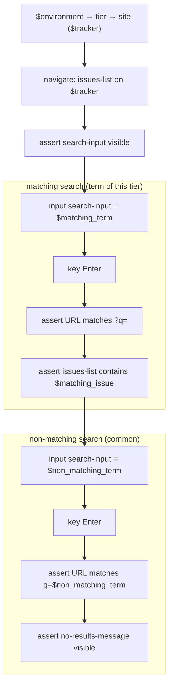

# search-issues-on-tier

Search the issues list of one tier of the demo app and assert the filtered
result state: the tier's pinned issue for a matching term, the empty state for
a non-matching one.

**At a glance** — App: `sitemapper-demo` · Tiers: required `prod`, `dev` ·
Mode: deterministic · Trust: draft · Effect: read-only · In: `$environment`
(prod | dev) → fixtures of that tier (`$tracker`, `$matching_term`,
`$matching_issue`) → Out: none (assert-only)

This is `search-issues` written as a project workflow: one file for every tier.
`environment` picks the tier, the app (`apps/sitemapper-demo/app.yaml`) maps the
tier to a site, and every step names the site by its role `$tracker`, which the
tier's fixtures block resolves. `tiers.required` is what a scheduler and a parity
check read; a tier of the app that is neither allowed nor declared absent fails
`check.py`.

```
python scripts/run.py search-issues-on-tier --param environment=prod
python scripts/run.py search-issues-on-tier --param environment=dev --record
```

## Flow



## See also

- [`search-issues-on-tier.yaml`](search-issues-on-tier.yaml)
- The app: [`../../../apps/sitemapper-demo/app.yaml`](../../../apps/sitemapper-demo/app.yaml)
- The single-site original: [`../../../sites/sitemapper-demo/workflows/search-issues.md`](../../../sites/sitemapper-demo/workflows/search-issues.md)
